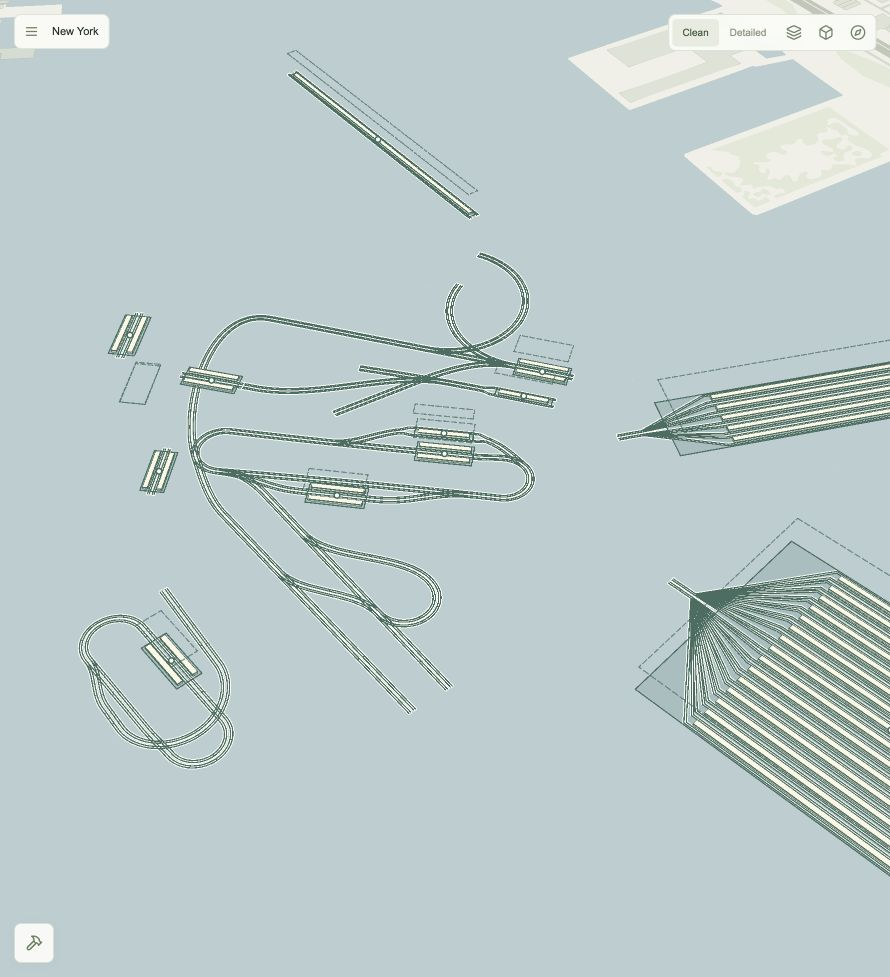

# Undergrid

**Build the city beneath the city.**

Undergrid is an early-alpha metro planning game for the browser. Explore New York on a real OpenStreetMap basemap, study where people live and work, and plan a metro network with parallel tracks, station platforms, depots and physical rail depths.



## Current features

- New York City and its surroundings, with a full-window map and a minimal interface.
- Clean and Detailed display modes, 3D buildings, and a camera you can rotate and tilt.
- Population density, workplace density and district boundaries.
- Existing railway alignments and an estimated foundation-risk overlay.
- Two-click station placement with 50–300 m length, Side/Island platforms and rail elevations from −100 to +50 m.
- Single/Parallel track blueprints with snapping along existing tracks and blueprints, reusable station connections, compact approaches, right-hand arrows and demolition.
- Two thin rails per track, separated by 1.5 m; parallel routes display four rails through stations, curves and depots.
- Depot blueprints with capacity for 5–30 train sets, entrance connections and local saving.
- Stations, depots and tracks at physical rail depths on the normal map, with station ground outlines at 0 m.
- Station names/depths and track depth transitions on hover, with an option to keep labels visible.
- Platforms with a 1.5 m raised deck, shaded walls and outlined edges; 3D buildings cover underground schematics behind them.
- Undo and Ctrl/Cmd+Z for construction actions, including whole station-and-connector transactions.
- Station placement snapped to free track ends, inheriting direction and depth.
- Local automatic saves, Continue, named Save/Load Game slots, and restoration of the world and camera after a page reload.
- Camera performance improvements with deferred building-support updates, cached picking and on-demand snapping; Retina sharpness is retained.

**This is a prototype in active development.** Station, depot and connecting-track construction are available. Train operations and the economic simulation are still planned. New track plans check turn radius, grade and vertical transitions before Build. Current gameplay limits are a 20 m minimum radius and a 16% maximum grade; these are permissive game settings, not engineering standards. Costs, terrain and clearance checks are still planned. Foundation values are gameplay estimates, not verified underground construction data. The earlier 3D metro experiment is retained in the source but is not enabled.

## Screenshots

### Main menu


### Population and map layers


### Controls and credits

<p>
  
  
</p>

The opening screenshot shows the current construction renderer. The menu and map-layer gallery shows earlier alpha milestones; the fictional visual preview has since been removed. Map data: © [OpenStreetMap contributors](https://www.openstreetmap.org/copyright), [OpenMapTiles](https://openmaptiles.org/) and [OpenFreeMap](https://openfreemap.org/). Density layers use U.S. Census Bureau and NYC Department of City Planning data; the in-game Credits screen and [development notes](docs/development.md) describe the sources.

## Run locally

Requires Node.js **20.19+ or 22.12+** and npm.

```sh
git clone https://github.com/Marat-ctrl/undergrid.git
cd undergrid
npm install
npm run dev
```

Open the localhost URL printed by Vite. Internet access is needed for map tiles and fonts. Population and workplace datasets are included locally; no API keys are required.

Choose **New Game → New York → Start**, or **Continue** to resume. Open **Construction** to draw your network. Stations snap to free track ends; click the start and stretch 50–300 m. Hover a station to inspect its name and rail depth. Enable **Map layers → Always show labels** for permanent labels.

| Control | Action |
| --- | --- |
| Drag | Pan the map |
| Scroll | Zoom |
| Right-drag or Ctrl + drag | Rotate and tilt together |
| Cube | Toggle tilt |
| Compass | Face north |
| Shift while drawing tracks | Lock a straight departure |
| Right-click without dragging | Cancel the current drawing |
| Ctrl/Cmd+Z or Undo | Cancel a drawing or undo the last construction action |
| Hover station | Show its name and rail depth |
| Escape | Cancel drawing, close panels or open the menu |

### Construction and saves

Track construction snaps to any point along existing tracks or blueprints. Choose **Single** for crossovers between individual tracks and **Parallel** for paired branches. Junctions inherit position, elevation and tangent and remain available for more connections. Stations snap to free track ends. Ordinary track centres are 4 m apart; Island station centres are 8 m apart. Station platforms and depot service decks are 4 m wide. The 1.5 m rail gauge and platform height are provisional game dimensions.

Use **Save** in the pause menu to name a snapshot. **Load Game** in the main menu lists saved games; **Continue** resumes the quick save. Snapshots include the camera, map layers, stations, depots, tracks and blueprints. Duplicate names create separate snapshots without overwriting older saves. Undo history lasts for the current session and resets on reload or loading a save.

The local Vite server writes quick saves to `saves/quick-save.json` and named snapshots to `saves/manual/<UUID>.json`. Both are excluded from Git. Use `npm run dev` or `npm run preview`; a generic static host does not provide the local file-save endpoints.

## Development

Built with **TypeScript, React, Vite, MapLibre GL JS and Three.js**. MapLibre renders the basemap and buildings; a shared Three.js layer renders the player network at physical elevations. Interface and code are in English.

```sh
npm run build
npm test
```

For save-related changes, `npm run test:saves` runs only the local save checks. Use focused geometry tests for construction changes instead of repeating unrelated simulation checks.

- [Architecture, data sources and prototype notes](docs/development.md)
- [Station model research](docs/station-design.md)
- [Blender station asset specification](docs/blender-stations.md)

## Direction

The next goals are clearance validation, train routing and a realistic economic model. A future 3D underground view can build on the preserved prototype. These are development goals, not current features.
