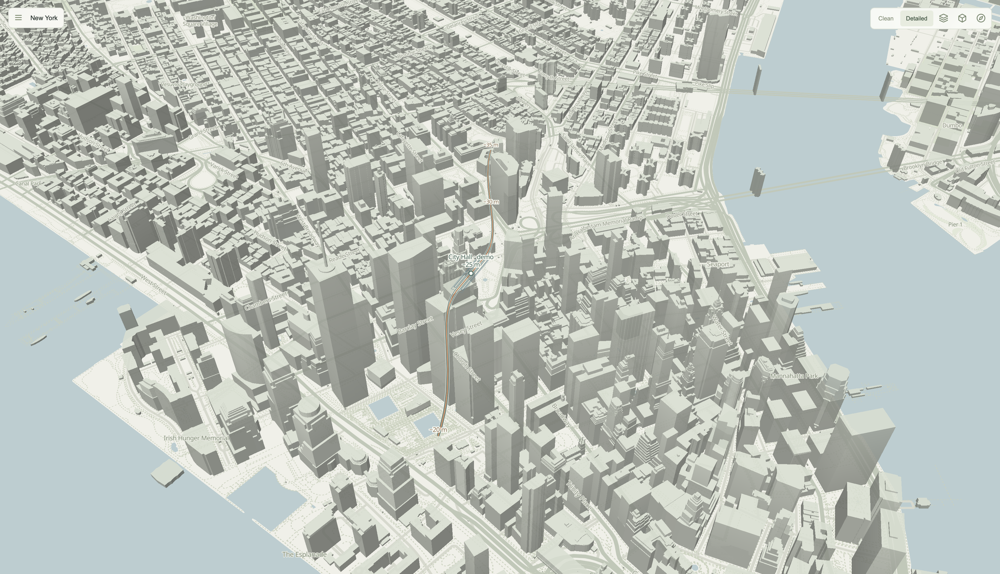
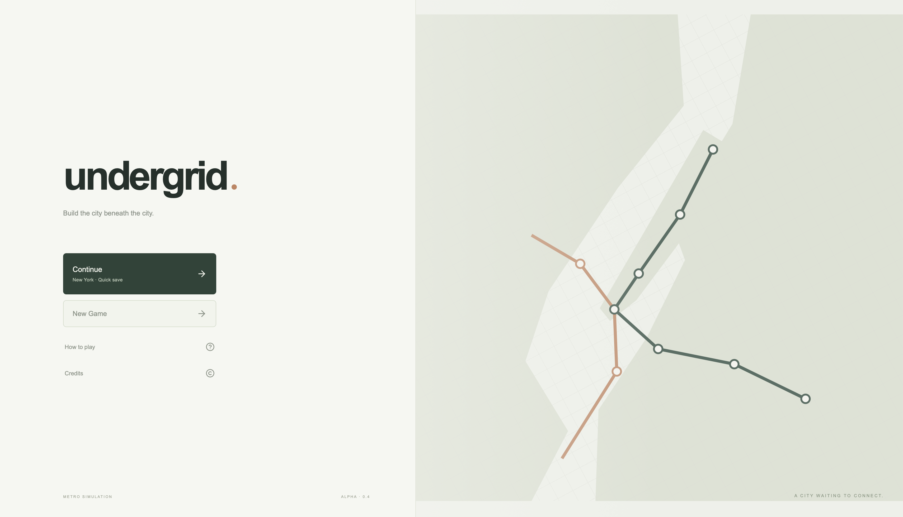
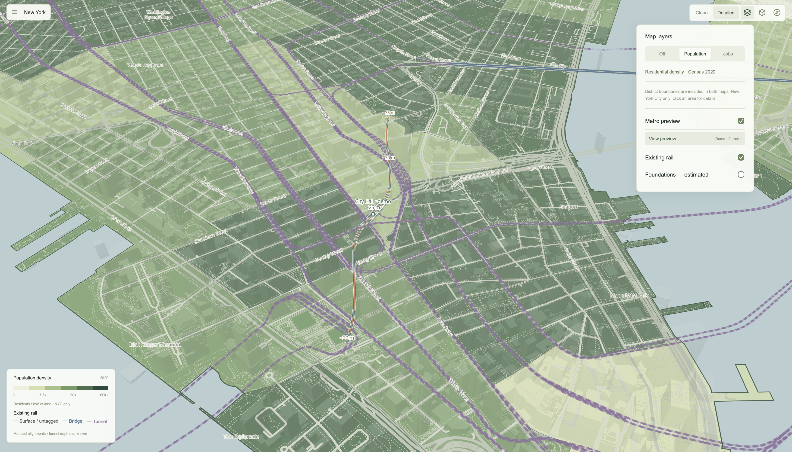
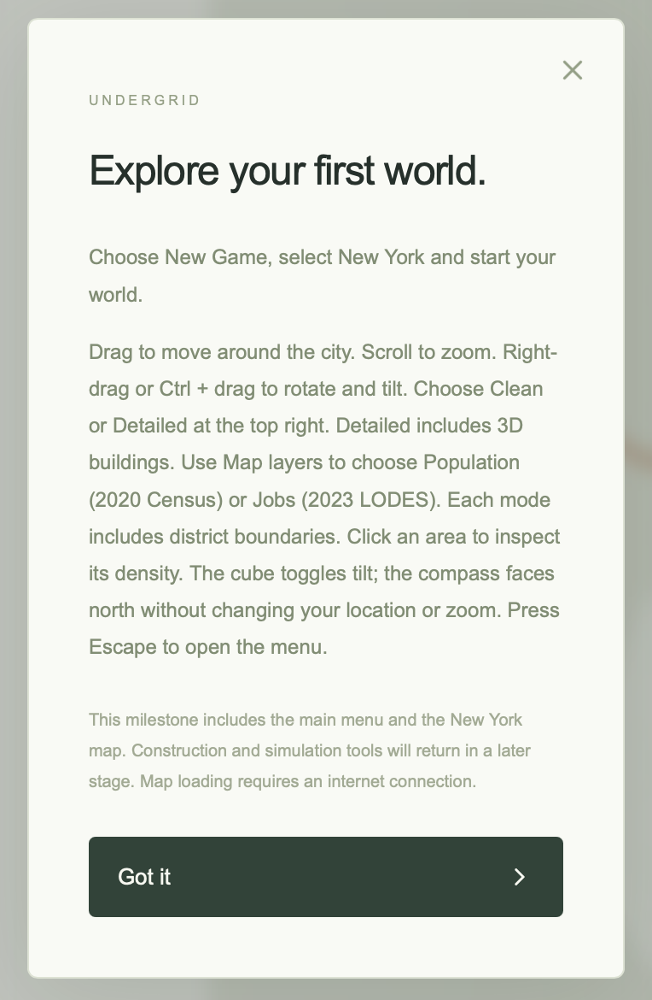
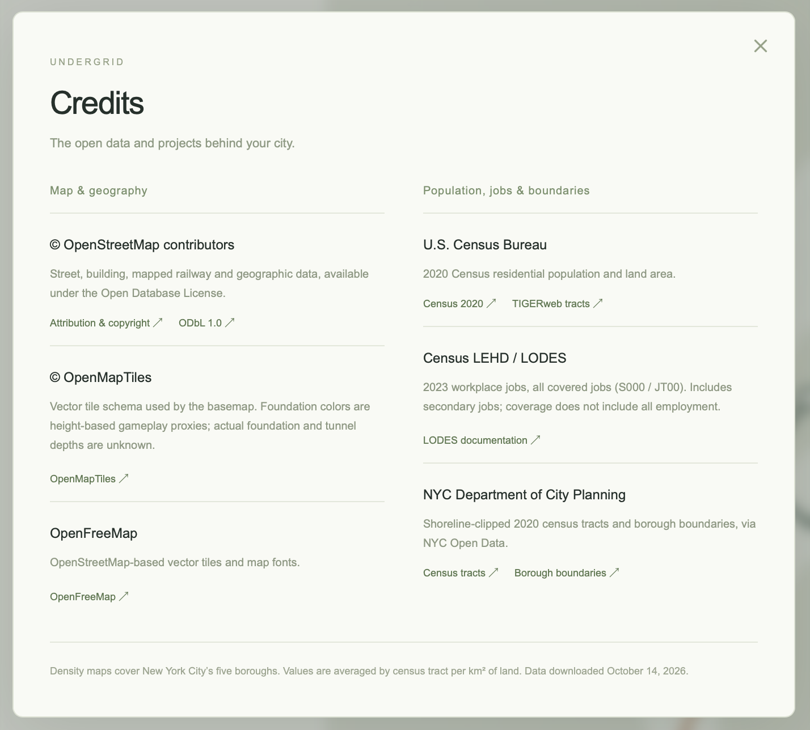

# Undergrid

**Build the city beneath the city.**

Undergrid is an early-alpha metro planning game for the browser. Explore New York on a real OpenStreetMap basemap, study where people live and work, and preview a metro network with parallel tracks, station platforms and depth labels.



## Current features

- New York City and its surroundings, with a full-window map and a minimal interface.
- Clean and Detailed display modes, 3D buildings, and a camera you can rotate and tilt.
- Population density, workplace density and district boundaries.
- Existing railway alignments and an estimated foundation-risk overlay.
- A 2D metro visual prototype: curved parallel paths, elongated station platforms and numerical depth labels.
- Local automatic saves, Continue, and restoration of the world and camera after a page reload.

**This is a prototype in active development.** The metro shown is a fictional visual preview. Player construction, train operations and the economic simulation are planned; they are not playable in the current interface. Foundation values are gameplay estimates, not verified underground construction data. The earlier 3D metro experiment is retained in the source but is not enabled.

## Screenshots

### Main menu



### Population and map layers



### Controls and credits

<p>
  
  
</p>

Screenshots show the current alpha interface. Map data: © [OpenStreetMap contributors](https://www.openstreetmap.org/copyright), [OpenMapTiles](https://openmaptiles.org/) and [OpenFreeMap](https://openfreemap.org/). Density layers use U.S. Census Bureau and NYC Department of City Planning data; the in-game Credits screen and [development notes](docs/development.md) describe the sources.

## Run locally

Requires Node.js **20.19+ or 22.12+** and npm.

```sh
git clone https://github.com/Marat-ctrl/undergrid.git
cd undergrid
npm install
npm run dev
```

Open the localhost URL printed by Vite. Internet access is needed for map tiles and fonts. Population and workplace datasets are included locally; no API keys are required.

Choose **New Game → New York → Start**. Use **Map layers → Metro preview → View preview** to focus the demo station.

| Control | Action |
| --- | --- |
| Drag | Pan the map |
| Scroll | Zoom |
| Right-drag or Ctrl + drag | Rotate and tilt together |
| Cube | Toggle tilt |
| Compass | Face north |
| Escape | Open or close the menu |

Saves are written to `saves/quick-save.json` by the local Vite server and excluded from Git. Use `npm run dev` or `npm run preview`; a generic static host does not provide the local file-save endpoint.

## Development

Built with **TypeScript, React, Vite and MapLibre GL JS**. Interface and code are in English.

```sh
npm run build
npm test
```

- [Architecture, data sources and prototype notes](docs/development.md)
- [Station model research](docs/station-design.md)
- [Blender station asset specification](docs/blender-stations.md)

## Direction

The next goal is map-based station and track placement with explicit depths, followed by blueprint construction, train routing and a realistic economic model. A future 3D underground view can build on the preserved prototype. These are development goals, not current features.
